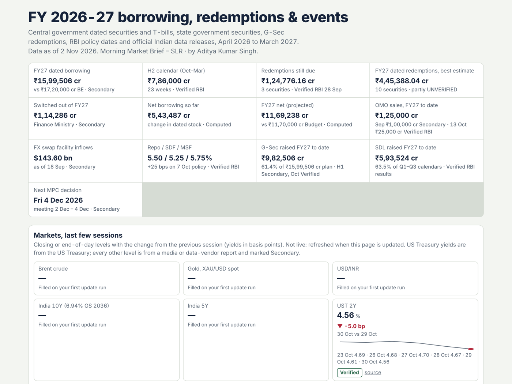

# Morning Market Brief – SLR

**A daily overview of India's government debt market, maintained by Claude from official releases, with every figure tagged against its source.**

Created by **Aditya Kumar Singh** · Free software under AGPL-3.0 with attribution terms



## What's in the brief

| Tab | What it shows |
|---|---|
| Facts strip | FY dated borrowing, H2 calendar, redemptions due, net borrowing so far and projected, OMO sales, policy rates, G-Sec and SDL raised to date, next MPC |
| Markets | Brent, gold, USD/INR, India 10Y and 5Y, UST 2Y/5Y/10Y, Baltic Dry, last few sessions |
| Calendar · Agenda | Every auction, redemption, MPC date, RBI operation, data release and tax outflow for the financial year |
| G-Sec & SDL curves | Curves built **only from RBI primary-market prints**: T-bill, dated G-Sec, OMO and SDL auction cut-offs |
| Borrowing math | Budgeted vs raised vs repaid, net borrowing from the change in outstanding stock, H2 net, full-year projection |
| Govt cash | Fortnightly net RBI credit to the Centre from the WSS |
| Maturities · G-Sec auctions · T-bills · SDLs | Auction-by-auction detail, to-date totals vs indicative calendars |
| RBI operations | OMOs, VRR/VRRR, FX swaps, switches, buybacks |
| Tax dates · Sources & flags | Advance tax, GST and TDS outflows; every source with its link |

Every figure is tagged **Verified** (read from the primary release), **Secondary** (media or third party) or **UNVERIFIED — CHECK MANUALLY**.

## How it works

1. The repo ships the brief as it stood on its **"Data as of"** date (`report/base_report.html`). The base is refreshed every week.
2. On your first run, Claude copies it to your computer and **catches up** on everything RBI, MoSPI and the market have published since that date.
3. Every morning after that, Claude reads the new releases, patches only what changed, checks the page with `scripts/mmb.py validate`, and gives you a short changelog.

The page itself is one HTML file in `~/MorningMarketBrief/report.html`. Open it in any browser.

## Requirements

- **Claude with web access and file access on your computer:** [Claude Code](https://docs.claude.com/en/docs/claude-code/overview), or the Claude desktop app with a folder connected. Each daily run uses your own Claude usage.
- **Python 3.9 or later.** Standard library only, nothing to install.

## Install

**Claude Code**
```
git clone https://github.com/YOUR-GITHUB-ACCOUNT/morning-market-brief-slr ~/.claude/skills/morning-market-brief-slr
```
Then ask Claude: *"Run the Morning Market Brief – SLR daily update."*

**Claude app:** download the repo as a ZIP and add it under Settings → Capabilities → Skills, then connect a folder for the report.

## Run it every morning (Claude Code)

**Windows (Task Scheduler):**
```
schtasks /Create /TN "Morning Market Brief SLR" /SC WEEKLY /D MON,TUE,WED,THU,FRI /ST 08:45 /TR "cmd /c cd /d %USERPROFILE%\.claude\skills\morning-market-brief-slr && claude -p \"Run the Morning Market Brief – SLR daily update.\" --allowedTools Bash,Read,Edit,Write,WebFetch,WebSearch >> %USERPROFILE%\MorningMarketBrief\run.log 2>&1"
```
**macOS / Linux (cron):**
```
45 8 * * 1-5 cd ~/.claude/skills/morning-market-brief-slr && claude -p "Run the Morning Market Brief – SLR daily update." --allowedTools "Bash,Read,Edit,Write,WebFetch,WebSearch" >> ~/MorningMarketBrief/run.log 2>&1
```
Check `claude --help` for the flags your version supports. 08:45 IST works well: RBI's overnight releases are out by then, and money-market operations follow at about 09:00.

## Commands

```
python scripts/mmb.py init        # first run: copy the base report to your folder
python scripts/mmb.py validate    # check the page: attribution, dates, tags, sources, script syntax
python scripts/mmb.py backup | restore | asof | path | open
python -m mmb_feed digest         # optional: parse RBI's feed directly (auction results, notices, liquidity, WSS)
python -m unittest discover tests
```

## Limits

- **Catch-up gets less reliable as the gap grows.** If your copy is weeks behind, download the latest base instead.
- **Each financial year needs a new base.** FY 2027-28 starts with new calendars and budget figures. That's a release the author makes.
- **The market strip is media-sourced** (except UST yields) and tagged Secondary. It is empty in the base and fills on your first run.
- **AI updates are not identical between users.** Figures come from the same official releases, but wording and the timing of captures can differ. Check the source link before relying on any figure.

## Data sources and disclaimer

See [NOTICE.md](NOTICE.md). Independent project, not affiliated with RBI, the Ministry of Finance, MoSPI or CCIL. Not investment advice.

## Licence and attribution

AGPL-3.0 ([LICENSE](LICENSE)) with additional attribution terms ([ADDITIONAL-TERMS.md](ADDITIONAL-TERMS.md)). In short: you may use, change and share it freely, but every copy, modified version and generated report must keep "Morning Market Brief – SLR · by Aditya Kumar Singh" and the attribution footer. Modified versions must be marked as modified and must stay under the same licence. To cite it, use [CITATION.cff](CITATION.cff) or GitHub's "Cite this repository" button.
